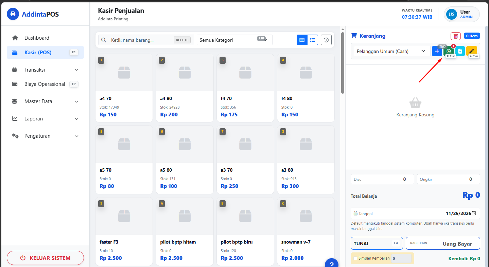
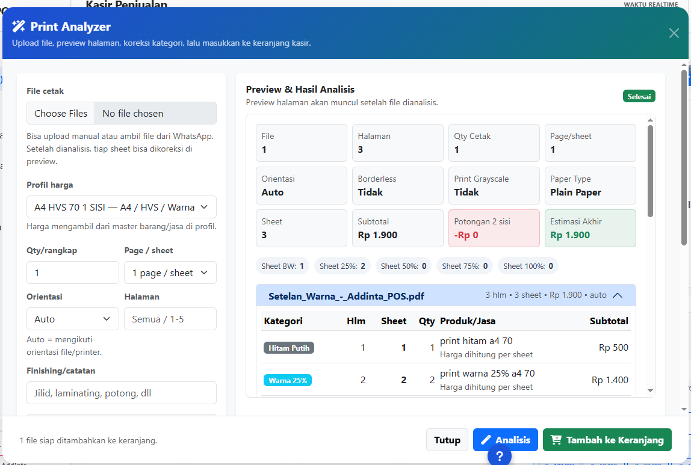
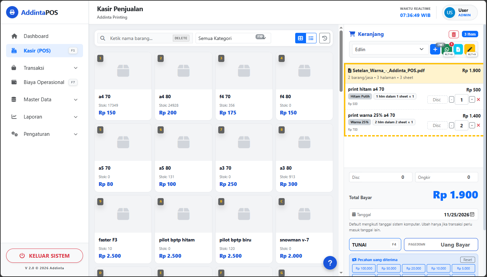
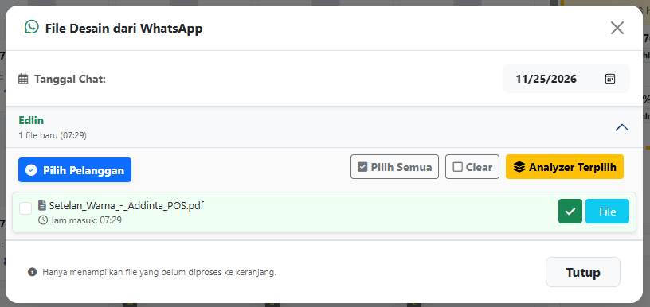
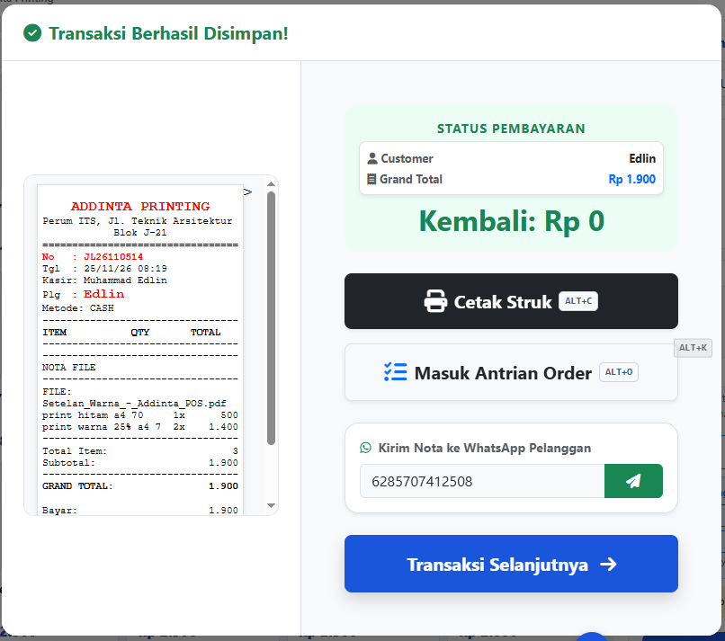
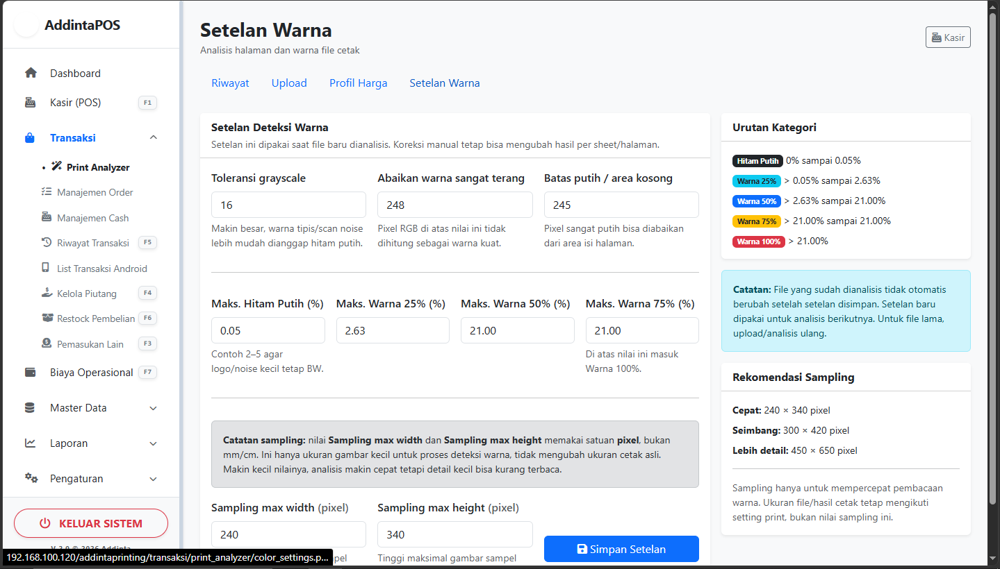

# POS: automatic color detection and pricing for print shops

Print Analyzer is the core module of AddintaPOS, a web POS I built and run at
Addinta Printing, Surabaya. It takes customer files from WhatsApp, analyzes
color coverage page by page, prices each job automatically, and hands it to
checkout, with receipts sent back over WhatsApp.

**Stack:** PHP · MySQL · JavaScript (jQuery, AJAX) · Node.js

**Result:** a typical 30-page color check went from 5-10 minutes to about
1 minute.

> Customer data in these screenshots is blurred or replaced with test data.
> Source code is private.

---

## How it works

1. A customer sends a file on WhatsApp, and the gateway downloads it.
2. The cashier analyzes the file: pages are classified by color coverage and
   priced per sheet.
3. The job goes into the cart, the customer pays, and the receipt is printed
   or sent back over WhatsApp.

---

## 1. New file notification

A badge on the WhatsApp button shows how many new customer files have arrived,
so the cashier knows a file is waiting without leaving the cashier screen
(shortcut: Alt+W).

---

## 2. WhatsApp file intake

A Node.js WhatsApp gateway downloads customer files automatically. The cashier
opens the list, picks a chat date, and sees files grouped by sender with the
time received. Files can be analyzed one by one or in a batch.

---

## 3. Print Analyzer

Uploads or WhatsApp files are previewed page by page, classified by color
coverage, and priced per sheet from a configurable price profile, with
per-sheet correction before checkout. Analysis takes roughly 3 seconds to
2 minutes depending on file size. In this example, a 3-page file is split into
1 black-and-white sheet and 2 sheets at 25% color.

---

## 4. Cashier screen

Analyzed jobs flow into the cart grouped by the printed file, with each color
tier as its own line (service, pages, sheets, quantity, price). The cashier can
adjust quantity, add a discount or delivery fee, and take cash payment with
quick-denomination buttons and keyboard shortcuts. In this example, the
3-page file from step 3 becomes two lines totaling Rp 1,900.

---

## 5. File status

Files that have been analyzed get a green check in the WhatsApp file list.
Once the transaction is completed, the file is no longer shown.

---

## 6. Receipt and WhatsApp delivery

After payment, the saved transaction shows the payment status and change,
plus a receipt preview with invoice number, date, cashier, customer, payment
method, itemized lines, and total. The cashier can print the receipt in one
click (Alt+C), send the job to the order queue (Alt+O), or send the receipt to
the customer's WhatsApp number through the same gateway that receives the
files. In this example, the 3-page file from step 3 closes as a Rp 1,900 cash
transaction.

---

## 7. Color detection settings

A settings page controls how pages are classified into five color tiers
(black and white, 25%, 50%, 75%, 100%): grayscale tolerance, near-white
cutoff, white-area limit, and the maximum color percentage for each tier.
Analysis runs on a small sampled image, with presets for speed (240 x 340 px),
balance (300 x 420 px), or detail (450 x 650 px). New settings apply to the
next analysis, and results can still be corrected manually per sheet.

---

## Contact

Muhammad Edlin Perkasa Alam · muhammad.edlin@gmail.com ·
[GitHub](https://github.com/muhammadedlinperkasaalam)